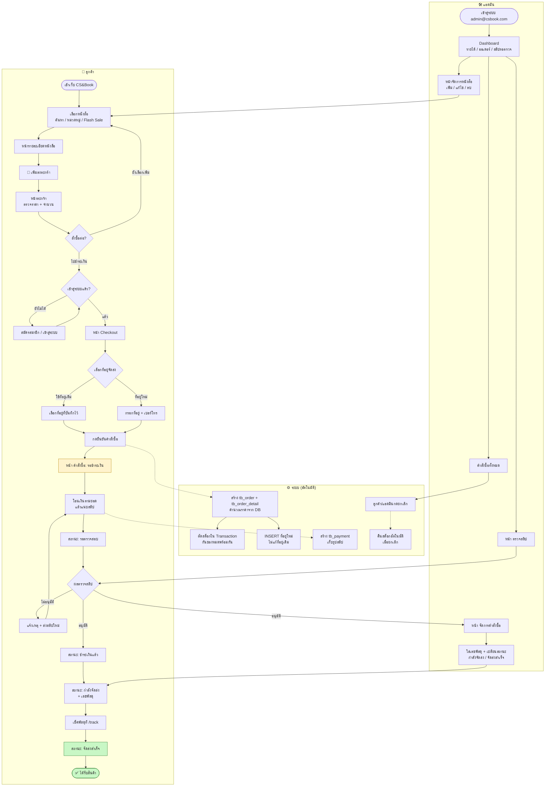
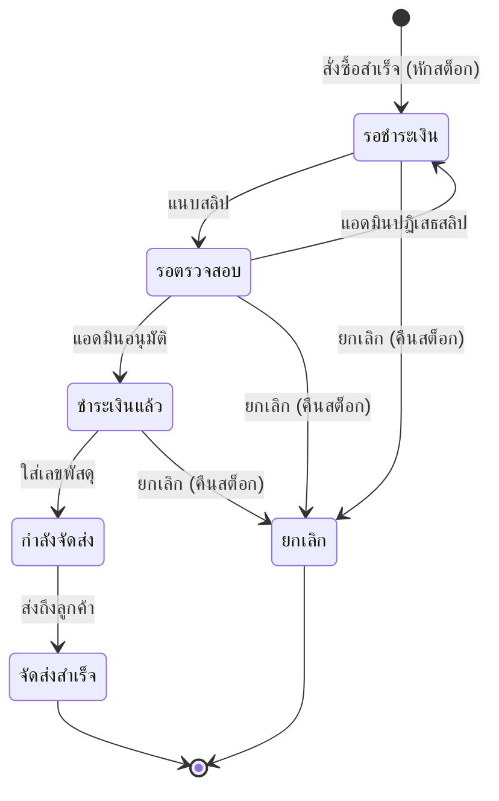

# 📊 Flowchart การใช้งานเว็บไซต์ CS&Book

> ภาพรวมการทำงานทั้งระบบ: ลูกค้า → ระบบ → แอดมิน
>
> 💡 เปิดดูแบบภาพสวยๆ ได้ที่ **http://localhost:3000/docs/flowchart.html**
> (หรือดูแบบข้อความด้านล่างนี้ใน GitHub)

## 1) เส้นทางการซื้อหนังสือ (ภาพรวมทั้งระบบ)

## 2) สถานะคำสั่งซื้อ (State Flow)

## 3) หน้าจอที่ใช้ในแต่ละขั้น

| ขั้น | ลูกค้าใช้หน้า | แอดมินใช้หน้า |
|---|---|---|
| เลือกหนังสือ | `/books`, `/books/[id]`, `/promotions` | `/admin/books` |
| ตะกร้า | `/cart` | — |
| สั่งซื้อ | `/checkout` | — |
| ชำระเงิน | `/orders/[id]`, `/payment-guide` | `/admin/payments` |
| จัดส่ง | `/orders`, `/track` | `/admin/orders`, `/admin/orders/[id]` |
| ภาพรวมร้าน | — | `/admin` |
